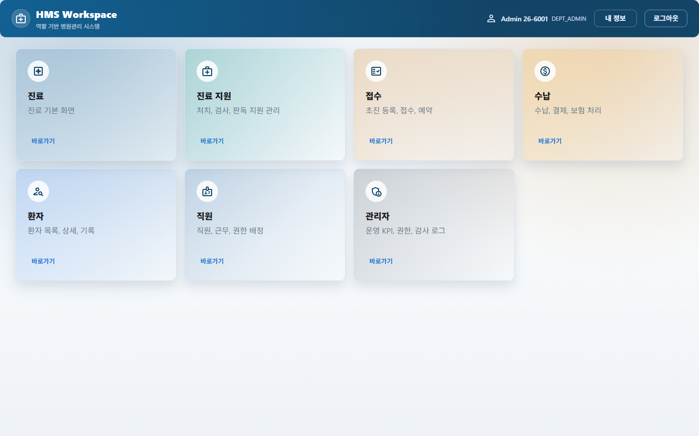
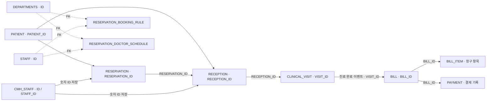
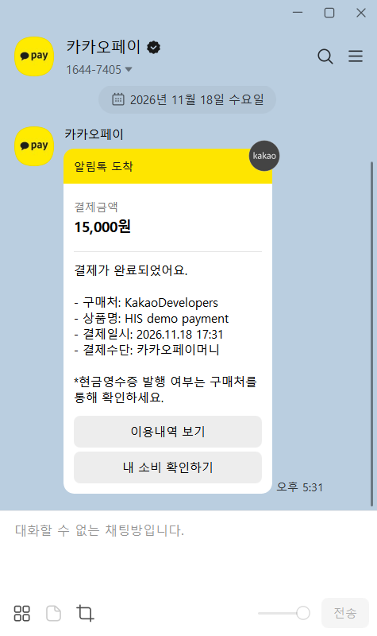

# 병원정보시스템(HIS) 로컬 통합 프로젝트

학원에서 함께 진행한 병원정보시스템을 바탕으로 서비스와 프론트엔드를 로컬에서 함께 실행하도록 정리한 프로젝트입니다. 이후 개인적으로 실행 환경과 서비스 연결을 정리하는 과정에서 AI 코딩 도구 Codex를 활용했습니다.

인증, 환자, 접수, 직원, 진료, 진료지원, 수납 서비스를 Next.js 화면과 연결합니다. Oracle XE, Redis, Kafka, MinIO를 Docker Compose로 함께 실행합니다.



## 구성

```text
브라우저 → Next.js
              ├─ 인증 · 환자 · 접수 · 직원
              └─ 진료 · 진료지원 · 수납
                          │
              Oracle · Redis · Kafka · MinIO
```

| 서비스 | 포트 | 역할 |
| --- | --- | --- |
| 프론트엔드 | 3001 | 병원 업무 화면 |
| auth-service | 8586 | 로그인 및 인증 |
| patient-service | 8182 | 환자 정보 |
| reception-service | 8283 | 외래 접수 |
| staff-service | 8023 | 직원 정보 |
| clinical-service | 8090 | 진료 |
| clinic-support-service | 8189 | 진료지원 |
| billing-service | 8081 | 청구와 수납 |
| Oracle XE / Kafka / Redis | 1521 / 9092 / 6379 | DB, 이벤트, 캐시 |
| MinIO | 9000 / 9001 | 파일 저장 / 관리 콘솔 |

## 개인적으로 정리한 작업

- 여러 서비스의 Dockerfile, 환경 변수, 네트워크 주소를 연결하고 Compose 실행 환경을 정리했습니다. [통합 커밋](https://github.com/babo99con/final_his/commit/7bb71dd915a9405a8bad0d839c2954a90efc159f)
- Oracle이 준비된 다음 데이터 덤프를 복원하고, 복원 성공 후 서비스를 시작하도록 구성했습니다. 기존 데이터가 재시작 때 덮어써지지 않도록 복원 상태를 확인합니다.
- MinIO 서버와 클라이언트는 공개 소스의 고정 버전으로 빌드합니다. 버킷 초기화는 별도 컨테이너에서 처리합니다.
- 진료 서비스의 Kafka 소비자가 컨테이너 내부에서 `kafka:9092`로 접속하도록 설정했습니다.
- 서버 세션 인증 전환을 별도 브랜치에서 실험했습니다. 이 변경은 [PR #1](https://github.com/babo99con/final_his/pull/1)에 있으며 현재 `main`에 병합되지 않았습니다. PR에는 Java 컴파일, 프론트엔드 린트와 빌드 결과가 기록되어 있습니다.

## 대표 테이블과 업무 흐름

아래 그림은 Oracle 덤프에서 업무를 따라갈 때 먼저 볼 테이블을 보여줍니다. 실선은 업무 데이터가 연결되는 경로이고, 예약 규칙과 일정의 점선은 복원 스키마에 실제로 정의된 외래 키입니다.



| 업무 | 대표 컬럼 | 코드에서 확인한 역할 |
| --- | --- | --- |
| 예약·접수 | `RESERVATION.PATIENT_NAME`, `RESERVATION.DEPARTMENT_NAME`, `RECEPTION.RESERVATION_ID` | 예약 이름 필드는 복원된 덤프의 필수값입니다. 예약 번호와 접수 번호는 각자 관리하고, 예약을 통해 생성한 접수는 예약 ID로 연결합니다. |
| 진료 | `CLINICAL_VISIT.RECEPTION_ID`, `CLINICAL_VISIT.PATIENT_ID` | 접수에서 시작한 진료를 접수 ID로 조회합니다. 청구 품목이 있으면 진료 완료 이벤트에 방문 ID와 품목을 넣어 Kafka에 발행합니다. |
| 청구·수납 | `BILL.VISIT_ID`, `BILL_ITEM.BILL_ID`, `PAYMENT.BILL_ID` | 청구는 진료 단위로 조회하고, 청구 항목과 결제 내역은 청구 ID로 연결합니다. |
| 의사 선택 | `CMH_STAFF.STAFF_ID`, `CMH_STAFF.ID` | 화면과 API가 쓰는 `DOC-*` 코드를 접수 서비스에서 숫자 ID로 변환합니다. 저장 후 조회 시에는 코드로 돌려줍니다. |

덤프에는 접수 화면에 표시할 진료과가 `STAFF_DEPARTMENT`에 들어 있습니다. 예약 생성 시 함께 저장하는 예약 규칙과 의사 일정은 `DEPARTMENTS`와 `STAFF`를 참조합니다. 새 볼륨을 복원할 때 [데모 초기화 SQL](infra/oracle/seed_reception_demo.sql)이 진료과 `1`과 의사 `919901`을 채워 이 외래 키를 만족시킵니다. 의사 코드 `DOC-DEMO-001`과 숫자 ID `919901`을 같은 데모 의사에 연결하며, 이미 있는 행은 건너뜁니다.

관련 코드 [예약 엔티티](HIS/microservices/reception-service/src/main/java/kr/co/seoulit/reception/reservation/entity/ReservationReceptionEntity.java) · [의사 ID 변환](HIS/microservices/reception-service/src/main/java/kr/co/seoulit/reception/persistence/DoctorCodeConverter.java) · [진료 완료 처리](HIS/microservices/clinical-service/src/main/java/com/example/hospitalClinical/encounter/service/EncounterServiceImpl.java) · [수납 연동](HIS/microservices/billing-service/src/main/java/com/hospital/billing/facade/BillingFacade.java)

## 화면 설계 참고

NHS.UK의 페이지 하단 지원 링크 배치와 NHS 공식 푸터 가이드를 참고했습니다. NHS는 업무를 진행하는 화면에서 하단 링크를 최소화하도록 안내합니다. 이 프로젝트는 본문 끝에 실제로 열 수 있는 프로젝트 문서 링크 하나를 두고, 데스크톱에서는 사이드바 오른쪽 본문과 들여쓰기를 맞췄습니다. [NHS.UK 적용 예시](https://www.england.nhs.uk/nhsidentity/examples/nhs-service-delivered-by-a-third-party-provider-website/) · [NHS Digital Service Manual – Footer](https://service-manual.nhs.uk/design-system/components/footer)

모바일 헤더는 NHS.UK의 좁은 화면에서 보조 탐색을 버튼으로 여는 방식을 참고했습니다. HMS의 상단 바에는 서비스 이름과 `메뉴` 버튼을 두고, 패널에서 계정 기능과 기존 권한별 업무 메뉴를 제공합니다. 긴 계정 이름과 버튼을 한 줄에 계속 배치할 때 잘리던 문제를 줄이고, 어디서 메뉴를 여는지 글자로 표시했습니다. [NHS.UK 서비스 화면](https://www.nhs.uk/nhs-services/) · [NHS 공식 헤더 가이드](https://service-manual.nhs.uk/design-system/components/header)

## 실행 방법

Git과 Docker Desktop이 필요합니다. Windows CMD에서 실행합니다.

```cmd
git clone https://github.com/babo99con/final_his.git
cd final_his
copy .env.example .env
docker compose up --build -d
```

처음에는 이미지 빌드와 Oracle 데이터 복원에 시간이 걸립니다. 상태를 확인합니다.

```cmd
docker compose ps -a
docker compose logs --tail 30 oracle-restore
```

`oracle-restore`가 종료 코드 0으로 완료되면 [http://localhost:3001](http://localhost:3001)에 접속합니다.

- 데모 로그인 ID: `26-6001`
- 데모 로그인 비밀번호: `1111`
- 프론트엔드: `http://localhost:3001`
- 인증 API: `http://localhost:8586`

기본 포트가 사용 중이면 `.env`에서 호스트 포트를 변경합니다. Toss 결제 승인을 시험할 때는 테스트용 `TOSS_SECRET_KEY`가 필요합니다. 약품·상병·처치 검색에 사용되는 `HOSPITAL.CODE_DETAIL`은 제공된 덤프에서 비어 있습니다.

## 데이터 유지 및 초기화

`docker compose down`은 컨테이너를 내리고 데이터 볼륨은 유지합니다. 다시 실행할 때 복원 완료 표시가 있으면 기존 Oracle 데이터를 사용합니다.

과거 버전으로 생성한 볼륨에 HOSPITAL 스키마가 있다면 자동 복원 없이 기존 데이터를 사용합니다. 최초 복원 도중 오류가 발생했다면 로그와 스키마 상태를 확인해야 합니다.

`docker compose down -v`는 이 프로젝트의 데이터 볼륨을 삭제합니다. 처음부터 재생성이 필요할 때 사용하세요.

## 실행 확인

- `docker compose up --build -d`로 서비스 이미지를 빌드하고 전체 컨테이너를 시작했습니다.
- 빈 Oracle 볼륨에서 스키마 복원, 재실행 시 복원 생략과 기존 스키마 보존을 확인했습니다.
- 데모 계정의 화면 로그인과 환자·접수·직원·진료·수납 API 응답을 확인했습니다. 진료지원 서비스의 Swagger UI도 응답했습니다.
- MinIO의 세 버킷 생성과 파일 쓰기·읽기, Kafka의 네 소비자 그룹 연결을 확인했습니다.

- 빈 Oracle 볼륨을 복원하면 데모 진료과와 의사가 자동으로 추가됩니다. SQL 재실행 시 추가된 행은 없었으며, 예약 생성과 외래 접수 후 두 API에서 의사 코드를 다시 조회했습니다.

- 공개용 덤프를 빈 Oracle 볼륨에 복원한 뒤 데모 로그인, 예약, 외래 접수, 진료·오더, Kafka 청구 생성과 현금 수납을 확인했습니다. 청구 잔액은 0원이었습니다.

## 카카오페이 테스트 결제

카카오페이 개발자센터 앱의 Web 플랫폼에 `http://localhost:3001`을 등록하고, 발급한 Secret key(dev)를 로컬 `.env`의 `KAKAOPAY_SECRET_KEY`에 입력합니다. 포트를 변경했다면 `KAKAOPAY_WEB_ORIGIN`에도 등록한 주소를 지정합니다. 키는 수납 컨테이너에 실행 시 전달됩니다. [단건결제 가이드](https://developers.kakaopay.com/docs/payment/online/single-payment)

미수납 청구 상세 화면에서 **카카오페이 테스트 결제**를 누르면 테스트 CID `TC0ONETIME`으로 청구 잔액 결제를 준비합니다. 서버는 주문 번호, TID와 금액을 Oracle에 저장하고, 콜백의 승인 결과가 이 정보와 일치하면 해당 청구에 수납 기록을 생성합니다. 카카오페이 취소와 환불은 현재 범위에 포함하지 않았습니다.

표준 Docker 이미지에서 데모 청구 `10003`을 검증했습니다. Next.js 서버가 승인 콜백을 받아 수납 API로 전달했고, 수납 API는 HTTP `200`을 반환했습니다. 카카오페이 주문 조회는 `SUCCESS_PAYMENT`였으며, Oracle에는 15,000원의 `KAKAOPAY` 수납 기록 1건이 `COMPLETED`로 저장됐습니다. 청구 상태는 `PAID`, 잔액은 0원이었습니다. 이때 콜백 로그에는 승인 토큰 값이 남지 않았습니다.

기존 테스트의 카카오페이 승인 알림 예시입니다.



## 이미지로 배포

기본 Compose 파일은 소스에서 이미지를 빌드합니다. 앱 이미지를 레지스트리에 게시하려면 `.env`의 `HIS_IMAGE_PREFIX`를 Docker Hub 사용자명으로, `HIS_IMAGE_TAG`를 배포 버전으로 설정합니다.

```cmd
docker login
docker compose build
docker compose push
```

다른 컴퓨터에서는 같은 `docker-compose.yml`과 이미지 이름을 지정한 `.env`를 두고 실행할 수 있습니다.

```cmd
docker compose pull
docker compose up -d --no-build
```

Oracle 복원 이미지에는 공개용 `HOSPITAL_EXPORT/hospital_public_demo.dmp`가 포함됩니다. 새 스키마에 역할·메뉴·부서 같은 참조 설정을 넣고, 가상 환자와 데모 계정만 별도로 작성해 내보냈습니다. 환자의 전화번호, 이메일, 주소, 생년월일, 주민등록번호 필드는 비어 있습니다. 데모 환자와 관리자 생성 SQL은 [seed_public_demo.sql](infra/oracle/seed_public_demo.sql)에 있습니다. MinIO 소스는 AGPL 라이선스가 적용됩니다. 이 구성의 계정과 비밀번호는 로컬 데모용입니다.

## 파일 구조

- `HIS/microservices/`: 병원 업무 백엔드 서비스
- `frontend/`: Next.js 화면
- `HOSPITAL_EXPORT/`: Oracle XE 덤프
- `infra/minio/`: MinIO 서버와 클라이언트 이미지 빌드
- `infra/oracle/`: Oracle 스키마 및 덤프 복원 이미지
- `docker-compose.yml`: 전체 실행 구성
- [LOCAL_SETUP_README.md](LOCAL_SETUP_README.md): 개별 서비스 수동 설치와 문제 해결 안내
